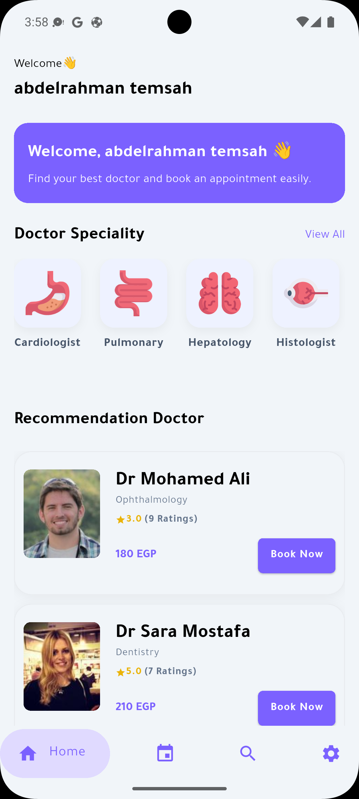
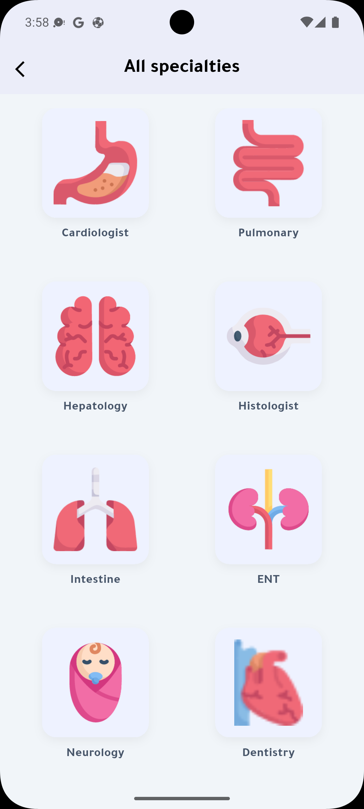
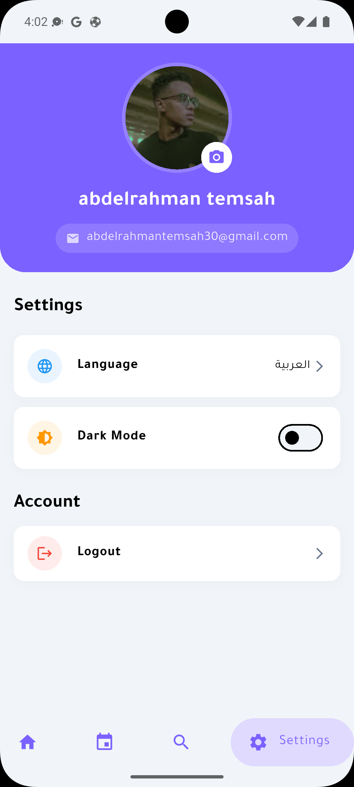
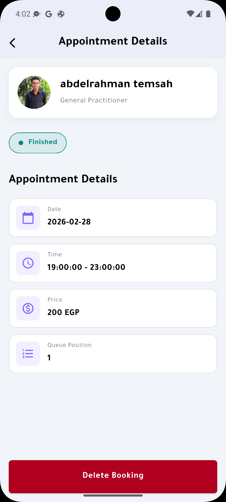
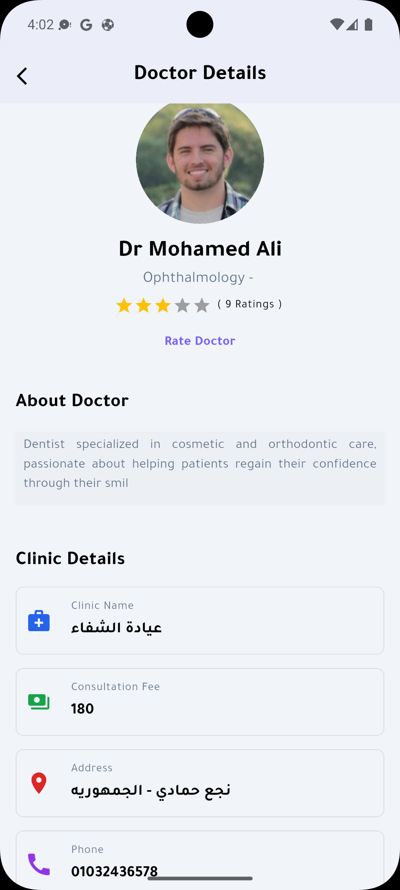

# Tabibak - Doctor Appointment Booking

Tabibak helps patients find doctors, check their schedules, and book medical appointments - no phone calls, no unnecessary waiting.

[](https://play.google.com/store/apps/details?id=app.temsah.tabibak)

## 📸 Screenshots

<p float="left">
  
  
  
  
  
</p>

## ✨ Features

- Search for doctors by name or specialty
- Browse all medical specialties
- Doctor profiles with bio and clinic details (address, phone, working hours)
- Book an appointment directly from the app
- Track upcoming and past bookings in one place
- Arabic-first UI with full RTL support, light and dark mode
- Sign in with Google, phone number with OTP verification

## 🛠️ Tech stack

- **Flutter & Dart**
- **State management:** Bloc / Cubit (`flutter_bloc`)
- **Backend:** Supabase + REST APIs (`dio`, `retrofit`)
- **Architecture:** feature-first structure with a shared core (dependency injection with `get_it`, routing, theming, networking layer), models generated with `freezed` and `json_serializable`
- **Storage:** `shared_preferences`, `cached_network_image`
- **Also:** `easy_localization` (Arabic / English), `pinput` (OTP), `google_sign_in`, `flutter_screenutil`

## 📁 Project structure

```
lib/
├── core/          # shared code: networking, routing, theme, DI, widgets, helpers
└── features/      # auth, home, splash, ... (data + presentation per feature)
```

## 🚀 Getting started

```bash
flutter pub get
flutter run
```
